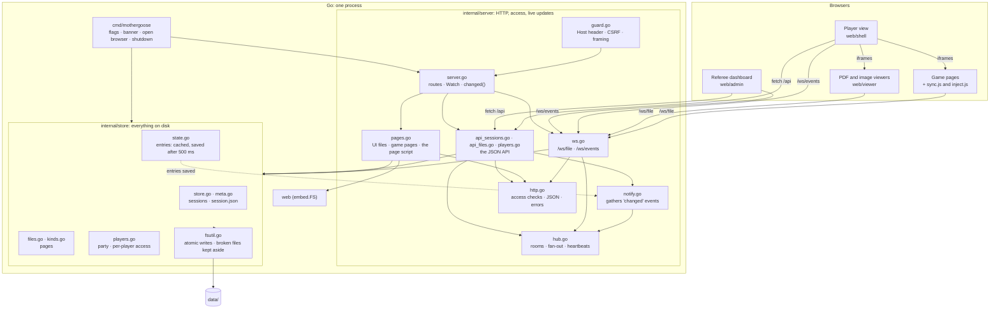
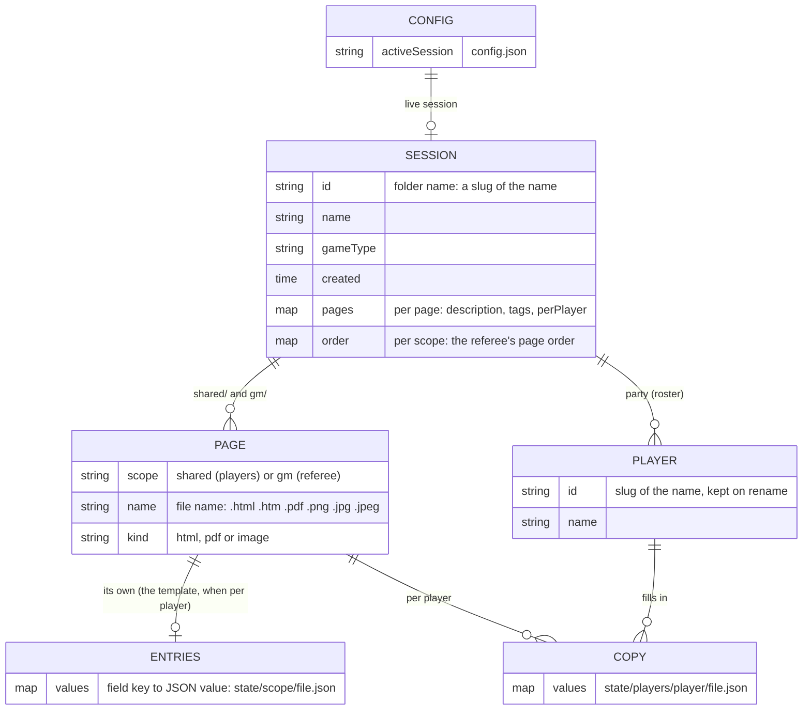
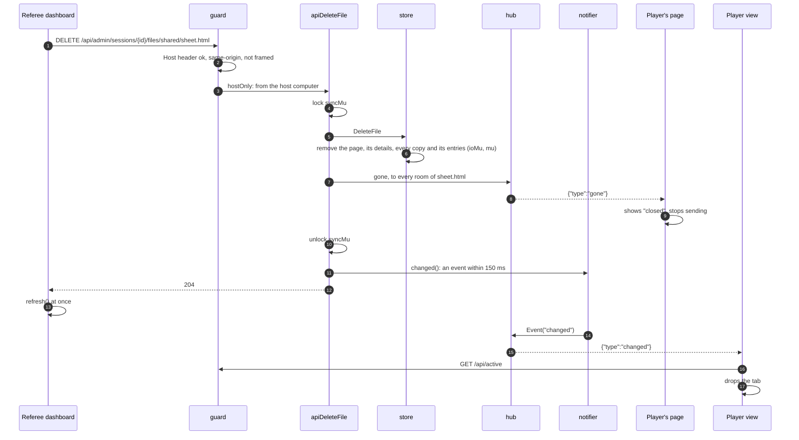
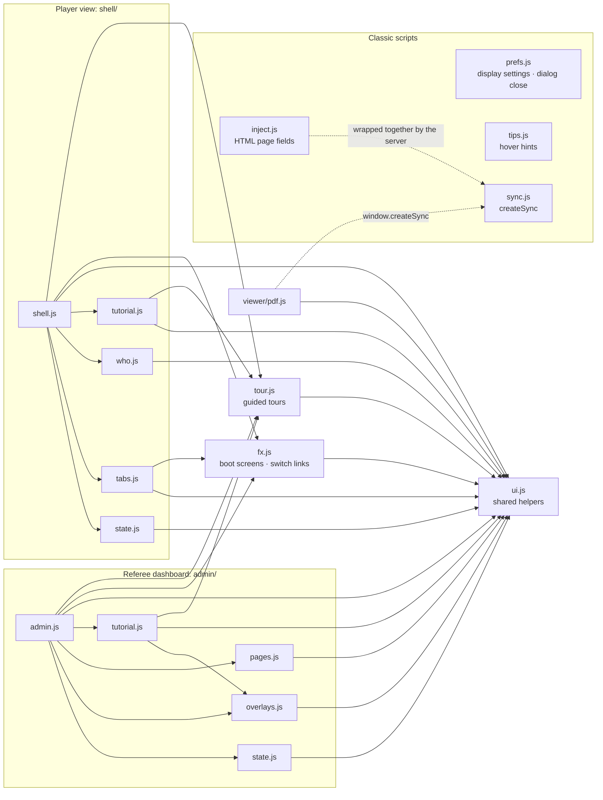

# MotherGoose architecture

How MotherGoose is put together, the rules that keep it simple, and how a request flows through it. The network protocol (endpoints, WebSocket messages, timings) has its own document: [NETWORK.md](NETWORK.md).

---

## What it is, and the constraints that shape it

MotherGoose is one program the referee runs on their own computer. It serves the referee's dashboard and the players' view over the local network, and keeps everything in a folder of plain files.

Five constraints drive almost every design decision:

1. **One binary, nothing to install.** Go, with the whole web UI embedded (`web/embed.go`). It has no database and no external services.
2. **A trusted LAN, not the internet.** There are no accounts, passwords or HTTPS. Access is decided by where a request comes from (the host computer or another device) and by which session is live.
3. **No build step for the UI.** Plain HTML, CSS and JavaScript ES modules, served as they are on disk. There is no bundler, no framework, and nothing to compile.
4. **A data folder people can read and edit by hand.** Sessions, pages and entries are ordinary files and JSON, safe to back up, copy into or fix with a text editor.
5. **Players' devices are anything with a browser**, including old phones. The PDF viewer uses PDF.js's legacy build, and the page script avoids modern-only syntax.

---

## The parts and how they depend on each other



The dependency rules are these:

- **`cmd` → `server` → `store`. Nothing goes the other way.** The store imports neither `net/http` nor WebSockets. The server never opens a file in the data folder itself: it has no `os.Open`, `os.ReadDir` or `filepath` of its own, and asks the store instead. The only file it reads directly is from the embedded `web.FS`.
- **The store tells the server about saved entries through one callback** (`OnEntriesSaved`), registered at startup. The callback must return at once and never call back into the store.
- **The browser code depends on the server only through HTTP and the two WebSockets.** It has no shared code with Go, so the wire format in NETWORK.md is the contract.

---

## Architecture rules

These are the rules the code follows. A change that breaks one should change the rule here too, on purpose.

### Boundaries

1. **The store owns the data folder and its rules.**
   - It covers names, kinds, sizes and limits, what a valid roster is, which pages can be per player, and that entries exist only for pages that exist (`checkState`).
   - Store errors wrap one of three sentinels (`ErrNotFound`, `ErrInvalid`, `ErrExists`). Each is written as a sentence a referee can read, because it reaches the dashboard as it is.
2. **The server owns who may do what.**
   - The host check (`isHostRequest`), the live-session check (`canView`) and which copy of a per-player page a request gets (`copyFor`) live in `internal/server`.
   - The store answers questions ("who is on the roster?"); the server decides.
3. **Every route goes through `guard` first** (Host header, cross-site requests, framing). Host-only routes are wrapped in `hostOnly` in `routes()`, in one place, so it's visible which routes are which.
4. **The UI talks to the server in one way per need:**
   - `api()` (in `ui.js`) for requests
   - `listenEvents()` for "something changed"
   - `createSync()` (in `sync.js`) for a page's entries

### Changes and live updates

5. **A change to the data is followed by telling the clients, in this order:**
   1. change the store
   2. broadcast `reload` or `gone` to the rooms affected
   3. call `s.changed()`

   Steps 1 and 2 run under `syncMu` whenever the change touches a page's entries, or whether a page or copy exists (delete, move, reset, the per-player switch, removing a player, deleting a session). An edit arriving over `/ws/file` is checked and stored under the same lock, so it can't land between a delete and its `gone`.
6. **`changed()` never sends straight away.** It asks the notifier for an event within 150 ms, and saved entries ask for one at most every 5 s. Every event makes every dashboard refetch, so they're gathered up.
7. **Typing never waits for the disk.**
   - Entries are kept in memory and saved by a timer. The timer writes while holding `ioMu` but not `mu`.
   - `SetValue` and `GetState` take only `mu`.
   - Admin operations that move or remove state files take `ioMu` first, so a save can never land after one of them.
8. **Lock order:** `syncMu` (server), then `ioMu`, then `mu` (store), then `hub.mu`. `metaMu` (`session.json` read-modify-write) is never held together with `ioMu` or `mu`. The notifier's lock is a leaf: nothing is called while holding it.
9. **Every `session.json` change goes through `updateMeta`.** It reads, changes and writes under `metaMu`, and repairs or sets aside a broken file instead of failing. Every write in the data folder is atomic (`writeAtomic`: temporary file, fsync, rename, fsync the folder).

### The UI

10. **No build step, and modules by feature.**
    - Each page has one entry module (`admin/admin.js`, `shell/shell.js`, `viewer/pdf.js`).
    - Each page's feature modules sit next to it.
    - Its shared state is one object in its own `state.js` (`A` for the dashboard, `S` for the player view).
    - An `app` object of functions lets feature modules ask the entry module to refresh or redraw without importing it, so there are no import cycles.
11. **Anything two pages need lives in `web/ui.js`:** formatting, escaping, the API helper, overlays, keyboard-shortcut checks and `listenEvents`. There are no local copies.

    The exceptions are the classic scripts, which can't import modules:
    - `prefs.js` and `tips.js` run before any module, on every page.
    - `sync.js` and `inject.js` run inside other people's HTML pages.

    The few helpers these repeat (`esc` in `prefs.js`) say so in a comment.
12. **Views are HTML strings, and every value from data goes through `esc()`.** Text set from data uses `textContent`. HTML typed by players into editable areas is cleaned against an allowlist before it is shown (`inject.js`), because it can come from any device.
13. **Listeners on redrawn content are attached once, to the container,** and find their target with `closest()`. A redraw never adds listeners.
14. **One sync client.**
    - `sync.js` holds everything about the `/ws/file` connection: batching, acks, echo suppression, reconnecting and dead-connection checks.
    - `inject.js` (HTML pages) and `pdf.js` (PDFs) only read and write their fields.
    - The server serves `sync.js` and `inject.js` as one script, wrapped in a function, so a game page gets exactly one global: `window.MotherGoose`.
15. **Styles:** `theme.css` holds everything shared (palettes, tokens, components, motion). Each page's own layout is in its own stylesheet (`admin/admin.css`, `shell/shell.css`, `viewer/viewer.css`).

    Display settings work as attributes on `<html>`:
    - `prefs.js` sets `data-theme`, `data-font`, `data-labels`, `data-motion` and `data-anim` before the first paint.
    - CSS keys off those attributes.
16. **Every dialog animates closed.** `prefs.js` patches `HTMLDialogElement.prototype.close` once, for every page. Code just calls `dialog.close()`. The tutorial opts a dialog out with the `mg-toured` class.

---

## Data model



On disk:

```
data/
  config.json                         which session is live
  sessions/<id>/
    session.json                      name, game type, players, page details, order
    shared/<page>                     players' pages
    gm/<page>                         referee's pages
    state/<scope>/<page>.json         a page's entries (the template, when per player)
    state/players/<player>/<page>.json  one player's copy
```

These rules follow from the model:

- **Only HTML pages and PDFs have entries.** Images have none (`HasState`).
- **Only players' HTML pages and PDFs can be per player** (`CanBePerPlayer`).
- **A copy starts from the template.** A player's copy that doesn't exist yet reads as the template. It becomes a file the first time that player writes to it.
- **Switching per player off keeps the copies,** and so does removing a player unless the referee says otherwise. They come back when the switch or the player does.
- **Deleting a page deletes its entries and every copy,** so a new page with the same name starts empty.
- **Limits:** names up to 120 characters, game types 60, descriptions 1,000, 12 tags of 32, 24 players with names of 40. Each field value is up to 1 MiB, HTML pages and images up to 32 MB, and PDFs up to 100 MB.

---

## How a request flows

Take the referee deleting a page while a player has it open:



The other flows follow the same shape:

- **A player types:** `inject.js` or `pdf.js`, then `sync.js` (batched for 200 ms), then `/ws/file`. Then `handleSet`, under `syncMu`: re-check access, `store.SetValue` (memory), pass it on to the room, ack. 500 ms later the store saves it, and the notifier tells the dashboards. NETWORK.md has the timings.
- **Opening a page:** the shell creates an `<iframe>`. For an HTML page, `serveGameFile` checks access, picks the copy and adds the entries and the page script. Then `sync.js` connects, and `joinCopy` sends the snapshot and joins the room in one step under `syncMu`. PDFs and images are sent as they are; the PDF viewer gets its entries over `/ws/file` the same way.
- **A file dropped into the data folder by hand:** `Watch` sees the fingerprint change within 2 s, and calls `changed()`.

---

## Frontend structure



| Page | Loads | Entry | Owns |
|---|---|---|---|
| `/admin` | `theme.css`, `admin/admin.css`, `prefs.js`, `tips.js` | `admin/admin.js` | Sessions list, the open session, party, page columns, actions, keyboard |
| `/` | `theme.css`, `shell/shell.css`, `prefs.js`, `tips.js` | `shell/shell.js` | Loading the live session, tabs and frames, sync status, full screen, keyboard |
| `/_mg/viewer/pdf.html` | `theme.css`, PDF.js's `pdf_viewer.css`, `viewer/viewer.css`, `prefs.js`, `tips.js`, `sync.js` | `viewer/pdf.js` | PDF.js viewer, zoom and pages, form fields, filled export |
| `/_mg/viewer/image.html` | `theme.css`, `viewer/viewer.css`, `prefs.js`, `tips.js` | `viewer/image.js` | Fit to screen, actual size |
| `/s/<session>/<scope>/<page>.html` | the referee's own page, plus `/_mg/inject.js` | `inject.js` | Saving and syncing the page's fields; `window.MotherGoose` |

What each feature module does:

| Module | What it does |
|---|---|
| `admin/overlays.js` | Join Info, data folder, session details and editing, a page's info popup with its party and copies, renaming and removing players |
| `admin/pages.js` | Uploads, files dropped from the computer, dragging pages to reorder or move them |
| `admin/tutorial.js` | The referee tutorial, with its example session |
| `shell/tabs.js` | This device's tab order and sizes, shrink-to-fit, the tab menu, dragging tabs |
| `shell/who.js` | The name in the top bar, picking or changing it, the "who are you?" panel, the referee's whose-copy strip |
| `shell/tutorial.js` | The player tutorial |

How the dashboard and the player view manage their state:

- **Loading:** a page loads everything it shows in one go (`refresh()` in the dashboard, `load()` in the player view), and redraws from its state object.
- **When it reloads:** on every `changed` event, after its own actions, on reconnect, and (dashboard only) every 60 s and when the tab becomes visible.
- **No partial updates:** the data is small, so refetching is simpler and can't drift out of step.
- **Redraws wait while you're busy:** the dashboard holds a redraw while the referee is typing, dragging or touring, then catches up. The player view keeps each page's `<iframe>` alive across redraws, so switching tabs never reloads a page.

---

## Adding things

**A new API route**
1. Add the handler to the file for its topic (`api_sessions.go`, `api_files.go`, `players.go`) and register it in `routes()`. Wrap it in `hostOnly` unless players must reach it.
2. Read the body with `decodeBody`/`bodyError`, and report store errors with `storeError`.
3. Put the rule in the store, not the handler, if it's about the data.
4. After the change: broadcast to the rooms affected (under `syncMu` if it touches entries, or whether a page exists), then call `s.changed()`.
5. Add a test next to the others. Document the route in NETWORK.md.

**A new kind of page**
- Add it to `KindOf`, `MaxSize`, `ContentType` and `checkContent` (`kinds.go`), and decide `HasState` and `CanBePerPlayer`.
- Add a viewer under `web/viewer/` if browsers can't show it directly, and route it in `viewUrl` (`ui.js`).
- If it has entries, its viewer uses `createSync` like `pdf.js`.

**A new display setting**
- Add it to `prefs.js` as a `data-*` attribute on `<html>`, with a default that sets no attribute.
- Key the CSS off it in `theme.css`.

**A new dashboard feature**
- Put it in a module next to `admin.js` or `shell.js`, reading the page's state object.
- Ask for a refresh through `app`, and import shared helpers from `ui.js`.
- Use one delegated listener on its container.

---

## Testing

- **Go:** `go test -race ./...`.
  - The store tests cover sessions, files, entries, copies, broken files, saving without blocking, and concurrent creates.
  - The server tests cover access, CSRF and rebinding, the API routes, live sync, acks, joining while someone writes, edits after a delete or move, the notifier, and the page script.
- **Browsers:** there is no automated browser test in the repository. Changes to the UI or the sync clients should be tried in a browser: both dashboards, both tutorials, an HTML page and a fillable PDF on two devices, and an exported copy offline.

---

## Known trade-offs and future work

- **No partial updates.** Every `changed` event refetches whole listings. That's fine for a table of players, and the notifier keeps it to a few refetches. A very large session (hundreds of pages) would want per-session events.
- **Host detection trusts the remote address.** Anything that relays other devices' requests from this machine (a local reverse proxy, some VPNs) would make them count as the host. The README's security notes say not to expose the port, but don't mention this case yet.
- **The first read of a page's entries happens under the store lock.** Each copy is read from disk once, then cached. Only saving was moved off the lock, because it happens continuously.
- **`session.json` is re-read for every access check** (`Access`). It's small and cached by the OS, but a busy session with many pages open does read it often.
- **The dialog-close patch** changes a platform prototype. It's done once, in `prefs.js`, and it is the reason dialogs close the same way everywhere. A page that loads MotherGoose's scripts gets it too.
