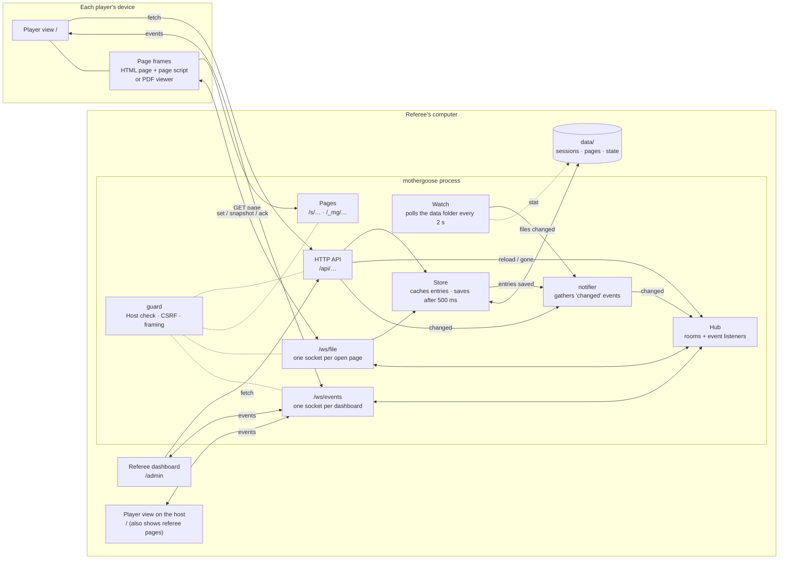
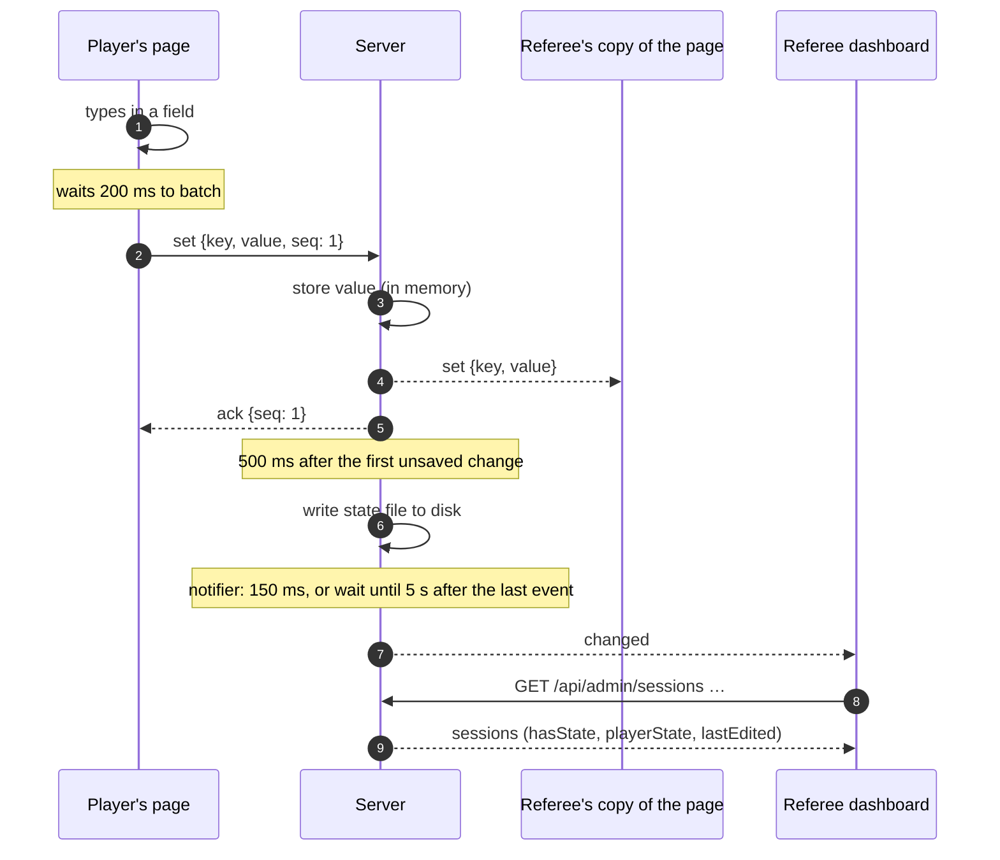

# MotherGoose network protocol

How the server, the referee's dashboard, the player view and the pages inside it talk to each other: who connects to what, which messages go over the wire, and when things update.

MotherGoose is a single Go process (`cmd/mothergoose`) serving plain HTTP on one port (8080 by default, or the next free one of the following nine). It is meant for a trusted LAN only: there are no passwords and no TLS.

---

## Architecture



There are three kinds of client. They all load their code from the server and keep at least one WebSocket open:

| Client | Loaded from | Sockets | What it does |
|---|---|---|---|
| **Referee dashboard** | `/admin` (`web/admin/`) | `/ws/events` | Manages sessions, pages and the roster over the HTTP API. Refetches everything it shows when told something changed. |
| **Player view** (the "shell") | `/` (`web/shell/`) | `/ws/events` | Shows the live session's pages as tabs, each in an `<iframe>`. Refetches `/api/active` when told something changed. |
| **Page frames** | `/s/<session>/<scope>/<file>` (HTML) or `/_mg/viewer/pdf.html?src=…` (PDF) | `/ws/file` | One per open HTML page or PDF. Syncs field values live. Images have no entries and no socket. |

On every connection the server decides two things:

- **Is this the host?** A request counts as the host if its remote IP is loopback or one of the machine's own addresses (`isHostRequest`, `internal/server/netinfo.go`). The host can open everything. Other devices can only open shared pages of the live session.
- **Which copy of the page?** On a per-player page, a player's device works on the copy of the player it picked. That pick is kept in the `mg_who` cookie, set through `POST /api/me`. The host can open the template or any player's copy (`copyFor`, `internal/server/players.go`).

### The guard

Every request passes through `guard` (`internal/server/guard.go`) before it reaches a route:

1. The `Host` header must be an IP address, `localhost` or this machine's own name. This blocks DNS rebinding.
2. A state-changing request from another site is refused (Go's `http.CrossOriginProtection`). As a second line of defence, JSON bodies must be sent as `Content-Type: application/json`.
3. `X-Frame-Options: SAMEORIGIN` and `frame-ancestors 'self'`: only MotherGoose's own pages may frame its pages.

---

## HTTP API

Everything returns JSON except the pages themselves. Routes marked *host* answer only to the host and return `403` with `{"error": "..."}` to anyone else.

| Method and path | Who | Purpose |
|---|---|---|
| `GET /api/active` | anyone | The live session, its files (shared files only, unless you are the host), roster and `me` (this device's player). |
| `POST /api/me` | anyone | `{"player": "<id>" \| null}`: pick or forget this device's player in the live session. Sets `mg_who`. |
| `GET /api/info` | host | Port, LAN URLs and data folder. |
| `GET /api/qr.png` | host | QR code of the players' address. |
| `GET /api/admin/sessions` | host | Every session, as summaries. |
| `GET /api/admin/sessions/{id}` | host | One session: files per scope, `hasState`, `playerState`, `lastEdited`. |
| `POST / PATCH / DELETE /api/admin/sessions/{id}` | host | Create, rename or change game type, delete. |
| `POST /api/admin/sessions/{id}/reveal`, `POST /api/admin/data/reveal` | host | Open the session's folder, or the whole data folder, in the computer's file explorer. |
| `POST /api/admin/sessions/{id}/activate`, `DELETE /api/admin/active` | host | Go live, end the session. |
| `POST /api/admin/sessions/{id}/files` | host | Multipart upload: `scope` plus one or more `files`. |
| `PUT /api/admin/sessions/{id}/order` | host | `{"scope", "names": [...]}`: page order. |
| `PATCH / DELETE /api/admin/sessions/{id}/files/{scope}/{file}` | host | Move or rename, delete. |
| `PUT …/files/{scope}/{file}/meta` | host | Description, tags, per-player switch. |
| `DELETE …/files/{scope}/{file}/state[?player=]` | host | Reset entries. |
| `GET …/files/{scope}/{file}/export[?player=]` | host | Filled-in HTML download. |
| `POST / PATCH / DELETE /api/admin/sessions/{id}/players[/{player}]` | host | Roster. |
| `GET /s/{session}/{scope}/{file}[?player=]` | per access rules | The page. HTML pages come back with their saved entries and the page script added before `</body>`. PDFs and images are sent as they are, with Range support. |
| `GET /_mg/inject.js` | anyone | The page script: `sync.js` and `inject.js` as one script, wrapped in a function. |
| `GET /_mg/…` | anyone | Static files: scripts, styles, fonts, the PDF viewer. |

The admin calls that change something also tell the clients about it, as described in [When things update](#when-things-update). (`POST /api/me` only changes the calling device's cookie, so it tells no one.)

---

## `/ws/file`: live entries for one page

```
GET /ws/file?session=<id>&scope=shared|gm&file=<name>[&player=<id>]
```

Each open copy of a page has a **room** on the server, keyed `session/scope/file` for the page's own entries or `session/scope/file/player` for one player's copy. The connection is refused with an HTTP error if the page has no entries (images), doesn't exist, or this device may not open that copy.

All messages are JSON text frames.

### Server → client

| Message | When |
|---|---|
| `{"type":"snapshot","state":{key: value, …}}` | Always the first message: every saved entry of this copy. |
| `{"type":"set","key":k,"value":v}` | Another client in the same room changed a field. Senders don't get their own sets echoed back. `null` means cleared. |
| `{"type":"ack","seq":n}` | The server has handled this client's set number `n`, and every earlier one. Sent even when the value was refused (a bad key, or larger than 1 MiB), because sending it again wouldn't help. |
| `{"type":"reload"}` | The page's file was replaced, its entries were reset, it was switched to or from per-player, or the player was renamed. The client reloads. |
| `{"type":"gone"}` | The page was deleted or moved, the session was deleted or ended (players only), or the player was removed. The client shows "closed", closes its socket and stops reconnecting. What's typed after that stays on the device. |
| `{"type":"ping"}` | A heartbeat every 25 s, so the client can tell a quiet connection from a dead one. |

### Client → server

| Message | Meaning |
|---|---|
| `{"type":"set","key":k,"value":v,"seq":n}` | Set one field. `seq` counts up from 1 per connection and is optional: without it, no ack is sent. Anything other than `set` is ignored. |

Before every set, the server checks again that this device may still write to this copy, since the session may have ended or the player been removed since the socket opened. If it may not, or the page no longer exists, the socket is closed with code `1008`.

### Keys and values

| Page | Key | Value |
|---|---|---|
| HTML (`inject.js`) | `#id`, `name:<name>`, `radio:<name>`, or `path:<tag:n>>…` for elements with neither; a `~2`, `~3` suffix tells duplicates apart | A string, a boolean (checkbox), an array (multi-select), or the HTML of an editable area. Remote HTML is cleaned against an allowlist before it is shown. |
| HTML, custom state | `custom:<name>`, set through `MotherGoose.set(name, value)` | Any JSON value. |
| PDF (`viewer/pdf.js`) | `pdf:<full field name>` | The field value as PDF.js stores it. |

Limits: keys up to 512 bytes, values up to 1 MiB, and a whole message up to 1 MiB + 8 KiB.

### Ordering

`syncMu` makes "save the value, then pass it on to the room" one step, and "take a snapshot, then join the room" another. So a client that joins never misses an edit made while it joined, and every client sees a field's changes in the order they were saved.

Deleting, moving or resetting a page, switching it to or from per-player, removing a player and deleting a session take `syncMu` too, around the change and its `gone` or `reload`. An edit can't land in between, so no entries are ever saved for a page that's gone.

### What the clients do

Both clients share one connection: `createSync`, in `web/sync.js`. `inject.js` (HTML pages) and `viewer/pdf.js` (PDFs) only read their fields, show values that arrive, and report the status. Everything below is `sync.js`, apart from focused fields and the status display.

- **Batching:** changed fields are kept in an *outbox* and sent 200 ms after the first change, as one `set` per field. They are also sent when the page is hidden or closed (`pagehide`).
- **Focused fields:** a remote value for the field you're typing in waits until you leave it (`focusout`), so the cursor doesn't jump.
- **Your edits win:** the snapshot replaces what the client knew the server had, except for fields still in the outbox whose value here differs from the snapshot. Those are sent once the snapshot is in.
- **Not acknowledged = not sent:** a sent set stays *unacknowledged* until its ack arrives. If the connection closes first, unacknowledged fields go back into the outbox and are sent again after reconnecting.
- **No echoes:** the client never sends a value the server is known to have, the last one it sent or received. Otherwise pages whose scripts calculate fields (fillable PDFs, HTML character sheets) would bounce the results between devices running the same scripts.
- **Dead connections:** the client gives up on a socket and opens a new one if it has heard nothing for 60 s, or if a send isn't acknowledged within 20 s. A connection lost without closing (Wi-Fi gone, laptop asleep) can otherwise stay "open" in the browser for minutes.
- **Reconnecting:** after 0.5 s, 1 s, 2 s, 4 s, then every 5 s.
- **Status:** a page inside the player view posts `{mg: "status", status}` to its parent, which shows it in the info bar. A page opened on its own shows a small dot instead. The statuses are `connecting`, `live`, `offline` and `closed` (plus `offline-copy` in an exported file).

---

## `/ws/events`: telling dashboards something changed

```
GET /ws/events
```

This socket is opened by the referee dashboard and by every player view. It carries no data, only nudges:

| Message | Meaning |
|---|---|
| `{"type":"changed"}` | Something the dashboards show has changed. Refetch. |
| `{"type":"ping"}` | A heartbeat every 25 s. Ignored apart from the 60 s dead-connection check. |

On every (re)connect, and on every `changed`, the client refetches:

- **The referee dashboard** fetches `GET /api/admin/sessions` and the selected session, then redraws. It waits while the referee is typing in a text field, while a page is being dragged, or while the tutorial runs, and catches up afterwards.
- **The player view** fetches `GET /api/active`, then adds or drops tabs, and reloads a PDF or image frame whose file changed.

Anything the client sends on this socket is read and ignored.

---

## When things update



Each kind of change reaches clients at its own speed:

| Change | Who hears | How | Typical delay |
|---|---|---|---|
| A field value | Everyone viewing that copy | `set` on `/ws/file` | 200 ms batching + network |
| A page's entries, as the dashboards see them ("filled" marks, "edited 2m ago") | Dashboards and player views | Saved to disk, then `changed` | About 0.85 s for the first edit, then at most one event every 5 s while someone keeps typing |
| Sessions, pages, order, roster, details, going live (any API change) | Dashboards and player views | `changed` | 150 ms (one event for a whole burst) |
| A page's file replaced, entries reset, per-player switched, player renamed | That page's open copies | `reload` on `/ws/file` | Instant |
| A page deleted or moved, session ended, player removed | That page's open copies | `gone` on `/ws/file` | Instant |
| Files added, changed or removed in the data folder by hand | Dashboards and player views | `Watch` sees the change, then `changed` | Up to 2 s, plus 150 ms |
| Time passing ("edited 2m ago") | Referee dashboard | 60 s timer while the tab is visible, plus a refresh when the tab becomes visible again | Up to 60 s |

### The notifier

Each `changed` makes every dashboard and player view refetch, so the server doesn't send one per change. `notifier` (`internal/server/notify.go`) keeps at most one event pending:

- **An API change** asks for an event within 150 ms (`changeDelay`). Every change made before it goes out shares it, so a burst of requests (pages dragged into place one after another, several uploads) sends one event, not one each.
- **Saved entries** ask for an event within 150 ms as well, unless an event went out less than 5 s ago (`entriesEvery`). In that case they wait for the rest of the 5 s. A player typing continuously therefore causes one refetch every 5 s, not two a second.
- **A sooner request brings a pending event forward.** A referee's change is never held up behind the 5 s entries wait.

The event is sent after the entries are on disk, so the refetch that follows already includes them.

### `Watch`

`Watch` (`internal/server/server.go`) checks the data folder every 2 s. It compares a fingerprint made of the live session, plus the modification times of each session's `session.json` and page files. Files dropped in by hand show up this way. State files aren't part of the fingerprint: their changes are announced when they're saved.

---

## Persistence

Entries live in memory (`Store.states`) and are written to `data/sessions/<id>/state/<scope>/<file>.json`, or `state/players/<player>/<file>.json` for a player's copy. A file is written 500 ms after the first unsaved change in it, so roughly every half second while someone types. The write happens without holding the store's main lock, so edits and page loads elsewhere never wait for the disk. Writes are atomic (a temporary file, then a rename). Everything still pending is written on shutdown.

A player's copy starts from the template's entries the first time they write to it.

---

## Connection health

| Mechanism | Where | Timing | On failure |
|---|---|---|---|
| WebSocket ping (needs a pong back) | Server, every socket | Every 25 s, 10 s timeout | Server closes the socket (`1001`) |
| `{"type":"ping"}` heartbeat | Server → every socket | Every 25 s | Client reconnects after 60 s of silence |
| Ack timeout | `/ws/file` clients | 20 s after a send | Client reconnects and sends again |
| Send queue | Server, per socket | 256 messages | A client that can't keep up is closed (`1008` "too slow") and reconnects with a fresh snapshot |
| Write timeout | Server, per message | 10 s | Server closes the socket (`1001`) |

Close codes the server uses:

| Code | Meaning |
|---|---|
| `1000` | The session ended: sent to players 500 ms after `gone`. |
| `1001` | A write or ping failed. |
| `1008` | No longer allowed (session ended, copy gone), or too slow. |
| `1011` | The saved entries couldn't be loaded. |

---

## Source map

| File | Contents |
|---|---|
| `internal/server/server.go` | Routes, `Watch`, `changed()` |
| `internal/server/api_sessions.go`, `api_files.go` | The HTTP API |
| `internal/server/ws.go` | `/ws/file` (`joinCopy`, `handleSet`) and `/ws/events` |
| `internal/server/pages.go` | Game pages, the page script (`/_mg/inject.js`) |
| `internal/server/hub.go` | Rooms, fan-out, per-socket write loop and heartbeat |
| `internal/server/notify.go` | Gathering `changed` events |
| `internal/server/players.go` | `mg_who` cookie, which copy a request gets, roster API |
| `internal/server/guard.go` | Host header, CSRF, framing |
| `internal/server/netinfo.go` | Host detection, LAN addresses |
| `internal/store/state.go` | Entries: the cache, saving outside the lock, copies |
| `internal/store/files.go` | Pages, and the fingerprint `Watch` compares |
| `web/sync.js` | `createSync`: the `/ws/file` client, shared by both below |
| `web/inject.js` | HTML pages' fields |
| `web/viewer/pdf.js` | PDF viewer and its form fields |
| `web/ui.js` | `listenEvents`, shared by both dashboards |
| `web/admin/admin.js` | Referee dashboard |
| `web/shell/shell.js` | Player view |

How these fit together is in [ARCHITECTURE.md](ARCHITECTURE.md).
